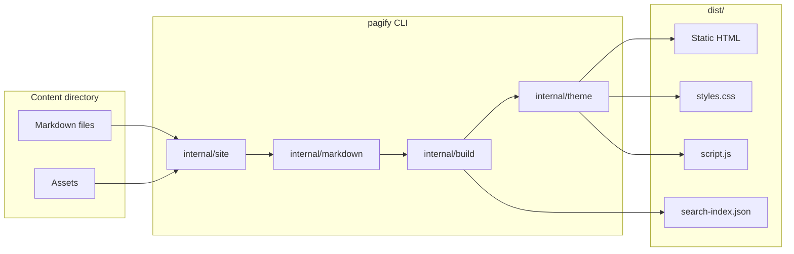

# pagify — System Architecture

## 1. Purpose

This document describes the system architecture, component responsibilities, data flows, trust boundaries, and failure-recovery strategies for pagify.

pagify is a **single Go CLI** with a strict layer separation:

```text
Markdown files
      │
      ▼
internal/site     discover pages, read frontmatter, map URLs,
                  resolve links, build the navigation tree
      ▼
internal/markdown parse and render: HTML, heading outline,
                  extracted title, link resolution, callouts
      ▼
internal/build    project onto the theme view model, resolve URLs,
                  write pages, assets, search index
      ▼
internal/theme    embedded template, stylesheet and scripts
      │
      ▼
dist/             static HTML, CSS, JS and assets
```

Each package depends only on the one above it. Nothing below knows what a URL looks like; nothing above knows what a tag looks like.

The primary architectural goals are:

- Clear separation between content, structure, and presentation.
- Zero-config default: everything in `pagify.yaml` is optional.
- Generated sites are static and self-contained.
- No JavaScript required for basic reading.

### High-level architecture

Source diagram: [`01-high-level-architecture.mmd`](./04-architecture/mmd/01-high-level-architecture.mmd)



## 2. Architectural Style

### 2.1 Layered monolith (Go)

A single Go binary contains the CLI, discovery, parser, builder, and theme. This is intentional: one binary, no runtime toolchain, no Node.js, no frontend framework.

Logical packages:

- `cmd` — CLI commands (`build`, `preview`, `serve`, `init`).
- `internal/site` — content discovery, frontmatter, URL rules, navigation.
- `internal/markdown` — Goldmark parsing, rendering, callouts, titles, outlines.
- `internal/build` — pipeline orchestration, view model, search index, asset copy.
- `internal/theme` — embedded template, stylesheet, scripts.
- `internal/server` — preview and JSON API server.
- `internal/workspace` — path confinement for the API.

### 2.2 Static generation

`build` runs the steps in order: config, discovery, render pages, write pages, write search index, copy assets. The output directory is replaced first, so a deleted page cannot survive a rebuild. When content has no index page, a landing page is generated from navigation.

### 2.3 Per-request preview and API

`preview` rebuilds on every request instead of watching the filesystem. `serve` runs the JSON API: `POST /api/v1/build` renders one page in memory; `/api/v1/health`, `/api/v1/openapi.json`, and `/api/v1/docs` describe it.

## 3. Component Responsibilities

| Component    | Responsibility                                          |
| ------------ | ------------------------------------------------------- |
| `internal/site`   | Discover pages, frontmatter, URL rules, navigation tree |
| `internal/markdown` | Parse and render Markdown, callouts, headings, links |
| `internal/build`    | Pipeline, view model, search index, asset copy        |
| `internal/theme`    | Embedded template, stylesheet, scripts                |
| `internal/server`   | Preview rebuild, JSON API                             |
| `internal/workspace`| Path confinement                                      |

### 3.1 internal/site

Answers "what pages exist and where do they go".

- `discover.go` walks the content directory once, collecting Markdown files and copying non-Markdown files as assets. Hidden files, `.bak`/`.backup` siblings, `_partials` directories and `pagify.yaml` itself are skipped.
- `page.go` splits frontmatter from the body and resolves each file to a URL (`guide/install.md` → `/guide/install/`) and an output path (`guide/install/index.html`). `index.md` and `README.md` are the landing page of their directory.
- `url.go` owns every URL and output-path rule, so the same file always maps to the same address.
- `nav.go` builds the sidebar from the file tree. A directory becomes a group; a directory with an `index.md` becomes a group that is also a link. The root landing page is moved to the front.
- `resolve.go` rewrites Markdown link and image destinations: `.md` links become clean URLs, root-relative links resolve against the content root, and everything passes through the base-path prefix.

### 3.2 internal/markdown

Owns Goldmark and knows nothing about visual design.

- `render.go` holds the single shared Goldmark instance, configured with GFM, footnotes, automatic heading ids and raw HTML passthrough.
- `transform.go` is one AST walk doing three jobs: collecting the heading outline, running link destinations through the caller's resolver, and marking GitHub-style callout blockquotes.
- `callout.go` renders a marked blockquote as the theme's `<aside>`.
- `title.go` lifts a document's leading level-1 heading out of the body as the page title.
- `outline.go` flattens heading inline markup into plain text for navigation.

### 3.3 internal/build

Ties the packages together and owns everything about one build.

- `config.go` reads the optional `pagify.yaml` and fills in defaults. A missing file is not an error; an unparsable one is.
- `render.go` projects a `site.Page` onto the flat view model the template consumes, and is the single place URLs are prefixed with the base path.
- `search.go` reduces each page's rendered HTML to plain text and writes `assets/search-index.json`.
- `build.go` runs the steps in order: config, discovery, render pages, write pages, write search index, copy assets.

### 3.4 internal/theme

The default theme is embedded in the binary with `go:embed`, so building a site needs nothing but the `pagify` executable.

- `theme.go` loads the template and exposes its assets as an `fs.FS`.
- `default/template.html` is a semantic document: `header`, `nav`, `main`, `article`, `footer`, plus an on-page outline.
- `default/styles.css` is a design system built on custom properties: tokens, reset, layout, header, sidebar, typography, links, code, tables, callouts, navigation, animations, responsive rules, dark mode, accessibility.
- `default/script.js` is progressive enhancement for the theme toggle, mobile drawer, code-block copy buttons and wide tables.
- `default/search.js` reads the generated index once and filters it in the browser.

## 4. Request Lifecycle

### 4.1 Build

1. `pagify build ./docs` reads config and defaults.
2. `internal/site` discovers Markdown and assets.
3. `internal/markdown` parses and renders each page.
4. `internal/build` writes pages, the search index, and copies assets to `dist/`.

### 4.2 Preview

1. `pagify preview ./docs` starts a local HTTP server.
2. Each request triggers a full rebuild.
3. The server honours `basePath` and serves static files only.

### 4.3 Serve

1. `pagify serve` starts the JSON API.
2. `POST /api/v1/build` renders one page in memory through `internal/workspace`.
3. Paths are confined to `--root`.

## 5. Concurrency

Builds are sequential within a single invocation. Preview rebuilds one request at a time, so there is no concurrent write to `dist/`.

## 6. Failure recovery

| Failure           | Behaviour                                                |
| ----------------- | -------------------------------------------------------- |
| Unparsable `pagify.yaml` | Build fails with an actionable error             |
| Missing Markdown  | Landing page generated from navigation; root still resolves |
| Deleted page      | `dist/` is replaced, so the page does not survive        |
| Theme asset missing | Build fails; the embedded theme is required           |

## 7. Security boundaries

- The CLI reads only the content directory it is pointed at.
- The `serve` API resolves every content path through `internal/workspace`, confined to `--root`; it cannot read outside.
- Generated HTML escapes Markdown content; raw HTML passthrough is opt-in via Goldmark.
- No secrets are embedded in the binary or generated output.

## 8. Technology mapping

See [`08-tech-stack.md`](08-tech-stack.md).

## Cross-references

- Data model: [`05-data-model.md`](05-data-model.md)
- API: [`06-api-specification.md`](06-api-specification.md)
- Deployment: [`11-deployment.md`](11-deployment.md)
