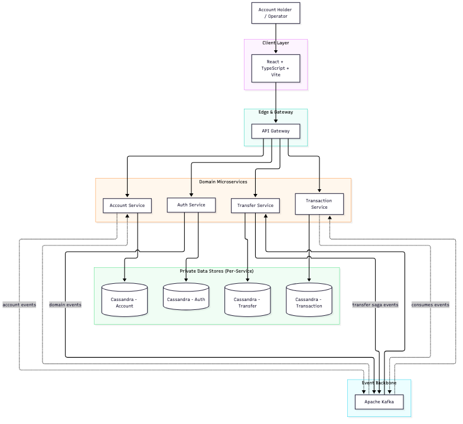
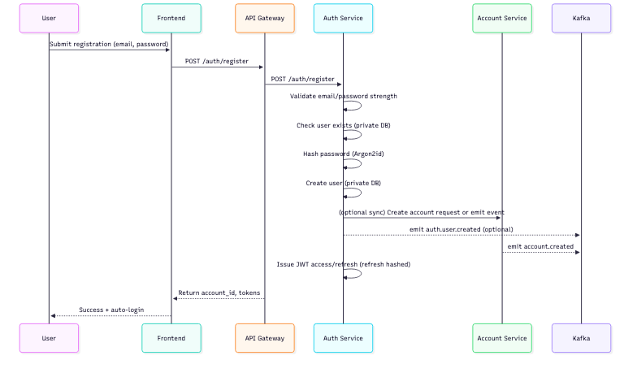
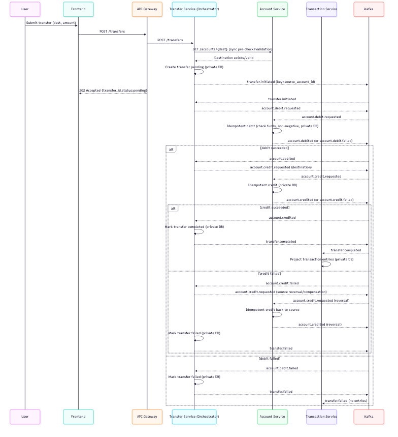

# NEO Bank — System Architecture

## 1. Purpose

This document describes the system architecture, component responsibilities, data flows, trust boundaries, and failure-recovery strategies for NEO Bank.

The architecture must support a secure banking workflow while remaining operationally robust. NEO Bank is designed as an event-driven microservices system with a choreography-orchestrated saga for transfers.

The primary architectural goals are:

- Clear separation of responsibilities between the interactive web application and background event processing.
- Strong account-scoped data isolation and service-level data ownership.
- Reliable asynchronous transfer processing using a saga pattern with exactly-once semantics.
- Financial data integrity with atomic balance updates and compensating actions.
- Safe handling of financial operations with idempotency guarantees and correlation identifiers.
- Explicit, parameterised queries with testable persistence boundaries.
- Observable failures and recoverable operations.
- Kubernetes-native deployment for production (EKS on AWS, GKE on GCP) with local parity via Docker Compose where practical.
## 2. Architectural Overview

NEO Bank uses an event-driven microservices architecture. Each business capability is implemented as an independently deployable service with private data storage. Transfer execution is orchestrated through a saga pattern using Kafka as the event backbone.

The frontend, API Gateway, domain services, and supporting infrastructure have distinct responsibilities. Kubernetes is the required deployment platform for all environments that approximate production; local development may use Docker Compose for developer ergonomics, but the design targets cloud-native orchestration.

The main architectural rules are:

1. **Service autonomy**: Each microservice owns its data and exposes well-defined APIs/events. No cross-service direct database access.
2. **Async processing for financial operations**: Transfer execution must not run inside synchronous web request handlers; it must be coordinated via a saga with events and compensating transactions.
3. **Data ownership**: Databases are private per service. Cross-service state is communicated only via API calls or domain events.
4. **Kubernetes required**: All production and pre-production deployments target Kubernetes (EKS/GKE). Kubernetes manifests and cluster provisioning are mandatory parts of the platform.
5. **Account isolation**: Every operation enforces account ownership; all queries are parameterised and account-scoped by a verified context.

### High-level architecture



Source diagram: [`01-high-level-architecture.mmd`](./04-architecture/mmd/01-high-level-architecture.mmd) · [`svg`](./04-architecture/svg/01-high-level-architecture.svg)

The diagram shows logical responsibilities. Kubernetes (EKS/GKE) runs each service as independently scalable workloads with private persistent data stores per service (dedicated Cassandra keyspaces/clusters as appropriate). Events flow through Kafka to drive the transfer saga.

## 3. Architectural Style

### 3.1 Event-driven microservices

NEO Bank is decomposed into bounded contexts, each implemented as an independently deployable microservice:

- **API Gateway**: Single entry point for all client requests; handles routing, authentication validation, rate limiting, CORS, and correlation/request IDs. No database of its own.
- **Auth Service**: Owns users, credentials, password hashing (Argon2id), JWT issuance/refresh, and token revocation. Data: users, users_by_email, refresh_tokens, refresh_tokens_by_user, audit_events.
- **Account Service**: Owns accounts and balances. Authoritative for account validation and balance reads/writes related to transfers. Data: accounts, audit_events.
- **Transfer Service**: Saga orchestrator. Owns transfer aggregate state and orchestrates the debit/credit flow via events. Manages saga state, idempotency for orchestration, and compensation logic. Data: transfers, transfers_by_account, idempotency_keys, audit_events.
- **Transaction Service**: Append-only read model for transaction history. Consumes transfer lifecycle events to build a denormalised view. Data: transactions, audit_events.

Each service writes its own `audit_events` table in its own keyspace; there is no shared audit store and no service reads another service's audit log.

Services communicate via:

- **Synchronous REST/gRPC** for queries requiring immediate consistency (e.g. balance lookup, account validation before initiating a transfer).
- **Asynchronous domain events** via Kafka for state propagation, saga coordination, and read-model projections.
### 3.2 Saga pattern for transfers

Transfer execution uses a saga (orchestration model) to maintain consistency without distributed two-phase commits. The **Transfer Service** acts as the saga orchestrator. Each step is idempotent and carries `correlationId`, `causationId`, and `idempotencyKey`. Compensation is performed on failure to ensure funds are never lost or created.

Key properties: eventual consistency, compensating transactions on partial failures, idempotent command handling, and exactly-once event processing semantics where feasible.
### 3.3 Per-service data ownership

Each microservice has **private data storage**. Cross-service database access is strictly forbidden. State is shared only via APIs or events.

- Auth Service: private Cassandra keyspace `auth_keyspace` (users, users_by_email, refresh_tokens, refresh_tokens_by_user, audit_events).
- Account Service: private Cassandra keyspace `account_keyspace` (accounts, accounts_by_user, processed_commands, audit_events).
- Transfer Service: private Cassandra keyspace `transfer_keyspace` (transfers, transfers_by_account, idempotency_keys, audit_events).
- Transaction Service: private Cassandra keyspace `transaction_keyspace` (transactions, audit_events).

There is no shared keyspace and no shared audit store: each service records its own `audit_events` in its own keyspace.

Services may use separate Cassandra keyspaces (recommended) or dedicated clusters depending on scale; in all cases, access control enforces data isolation.
### 3.4 Kubernetes-native (required)

Kubernetes is **required** for deployment. Production targets are **Amazon EKS** (AWS) and **Google GKE** (GCP), provisioned via Terraform. All services run as independently scalable Kubernetes workloads (Deployments/StatefulSets), with:

- Service discovery and load balancing (ClusterIP/Ingress).
- ConfigMaps/Secrets for configuration.
- Health, readiness, and liveness probes.
- Horizontal Pod Autoscalers (HPA) and Pod Disruption Budgets (PDB).
- NetworkPolicies to enforce least-privilege pod-to-pod communication.
- Per-service resource limits/requests and rolling updates with rollback support (`kubectl rollout undo`).

Local development may use Docker Compose to reduce friction, but the canonical deployment artefacts and platform requirements are Kubernetes-based. Cloud infrastructure (EKS/GKE, Terraform, Kubernetes manifests) is not optional for the target deployment model.
### 3.5 Explicit boundaries

Boundaries are enforced at the network and data layers:

- Edge/gateway boundary (client → API Gateway).
- Service boundary (gateway → domain services) with service-to-service authentication.
- Data boundary (service → private data store only).
- Event boundary (services ↔ Kafka, publish/consume via well-defined contracts).
- External infrastructure boundary (Kubernetes, Cassandra, Kafka, object storage if introduced).
## 4. Component Responsibilities

| Component | Responsibility |
|-----------|---------------|
| **Frontend** | Authentication UI, balance display, multi-step transfer flow, status monitoring, transaction history. UX validation only. |
| **API Gateway** | Routes requests, validates JWTs, enforces rate limits/CORS, injects correlation IDs, uniform error envelopes. No database of its own. |
| **Auth Service** | User registration/login, Argon2id password hashing, JWT access/refresh issuance, token revocation. Owns users, refresh tokens, and its own `audit_events`. |
| **Account Service** | Manages accounts and balances. Validates ownership, serves balance, executes debit/credit as part of saga. Enforces non-negative balances. Owns accounts data and its own `audit_events`. |
| **Transfer Service (Saga Orchestrator)** | Orchestrates transfer saga, creates transfer aggregates, tracks saga state, applies compensation on failure, manages idempotency. Owns transfers, idempotency keys, and its own `audit_events`. |
| **Transaction Service (Read Model)** | Consumes transfer lifecycle events to build append-only transaction history. Exposes paginated queries. Owns transaction read model and its own `audit_events`. |
| **Kafka** | Event backbone for saga coordination. Topic `transfers` with DLQ `transfers.dlq`. Ordering (partitioned by source account ID), `acks=all` in every environment; durability in production (RF=3, min.insync.replicas=2) — local/CI run a single broker at RF=1, min.insync.replicas=1. |
| **Cassandra (per-service)** | Private, authoritative storage per service. Amounts as integers in minor units (cents). Each service uses its own keyspace; audit data is never stored in a shared keyspace. |
### 4.1 Frontend

Technology: React 18, TypeScript, Vite, TanStack Query, React Router. Talks only to API Gateway.
### 4.2 API Gateway

Entry point. Validates access tokens, forwards to downstream services, enforces cross-cutting concerns, and never contains domain business logic.
### 4.3 Auth Service

Owns identity. Issues RS256-signed JWTs (access 15m, refresh 7d). Refresh tokens are hashed at rest. No direct access to other services' databases.
### 4.4 Account Service

Command-side processor for balance changes. Handles `debit` and `credit` commands idempotently as part of the saga, enforcing: positive amount, source!=destination, sufficient funds, and non-negative balance post-operation. Returns success/failure with reason codes.
### 4.5 Transfer Service (Orchestrator)

Maintains saga state machine per transfer. Publishes `transfer.initiated`, awaits `account.debited`/`account.credited` (or failures), emits `transfer.completed`/`transfer.failed`, and triggers compensation (e.g. reverse debit) on credit failure.
### 4.6 Transaction Service

Projection-only; never writes on its own except in response to events. Provides efficient, paginated history reads scoped to account ownership.
### 4.7 Messaging & persistence

Kafka uses topic `transfers` (DLQ `transfers.dlq`) with partitioning by source account ID to preserve per-account transfer ordering. Cassandra per service uses partition keys aligned to service boundaries (e.g. `account_id`, `transfer_id`, and the `transfers_by_account` lookup keyed by account) for data locality and isolation.
## 5. Repository and Module Boundaries

NEO Bank uses a polyrepo-friendly microservices layout. Each service is independently buildable and deployable. Frontend remains a separate deployable. Infrastructure (Terraform, Kubernetes manifests) lives at the repo root.

```text
neo.bank/
├── packages/
│   ├── backend/
│   │   ├── api-gateway/             # API gateway (Go) — routing, auth, rate limiting, no DB
│   │   ├── auth/                    # Auth microservice (Go)
│   │   ├── accounts/                # Account microservice (Go)
│   │   ├── transfer/                # Transfer orchestrator (Go)
│   │   └── transactions/            # Transaction read model (Go)
│   └── frontend/
│       └── app/                     # React + TypeScript (deployed independently)
├── infrastructure/                  # Terraform (EKS/GKE) + Kubernetes manifests
├── docker-compose.yaml              # Local developer topology (optional)
├── docs/                            # Normative documentation
└── .github/workflows/               # CI per service (or monorepo-aware)
```
### 5.1 Per-service structure (example)

Each Go service follows the same internal boundaries (API/handlers, core/config/security/errors, db, models, repositories, services/commands, consumers/projections):

```text
packages/backend/<service>/
├── cmd/api/main.go
├── cmd/consumer/main.go
├── cmd/migrate/main.go
├── internal/
│   ├── api/handlers, middleware, router  (HTTP/gRPC)
│   ├── core/config, logging, security, errors
│   ├── db/cassandra.go, migrations/
│   ├── models/domain models for this service
│   ├── repositories/parameterised queries (private DB only)
│   ├── services/business/command handlers or saga logic
│   ├── consumer/ (event consumers specific to this service)  # if consuming
│   └── producer/ (event publishers)                          # if publishing
├── go.mod
└── go.sum
```

**Rules:**

- No cross-service imports of internal code. Communicate via HTTP/gRPC or Kafka events only.
- Each service owns its migrations and schema.
- Direct database access is limited to the owning service.
- Avoid circular dependencies; services remain loosely coupled.
- Kubernetes manifests for each service live under `infrastructure/kubernetes/<service>/` (Deployments, Services, ConfigMaps, Secrets, HPA, PDB, NetworkPolicy).
### 5.2 Frontend structure

Frontend remains client-side and talks to API Gateway only. Structure unchanged conceptually: components, pages, lib/api, routing.
### 5.3 Deployment topology (Kubernetes required)

All services deploy to Kubernetes (EKS/GKE). Requirements:

- API Gateway exposed via Ingress (and optionally Cloud Load Balancer).
- Each service runs as Deployment with horizontal scaling; stateful components (if any) use StatefulSet.
- Cassandra and Kafka run in-cluster or via managed services (documented per environment); Terraform provisions required cloud resources.
- NetworkPolicies restrict traffic (default deny, allow only required paths).
- Per-service health/readiness/liveness probes, resource quotas, and rolling update strategy.
- Rollback via `kubectl rollout undo` is supported and tested.

Docker Compose is permitted for local development only and must not be required for production parity validation; Kubernetes manifests are the source of truth for deployment.
## 6. Request Lifecycle

### 6.1 General request (authenticated)

1. Frontend sends HTTP request with JWT access token to **API Gateway** (Authorization header).
2. Gateway validates token (signature, expiry, issuer/audience). Injects `X-Request-ID` and `X-Correlation-ID` if missing.
3. Gateway routes to target service (Auth/Account/Transfer/Transaction) via service discovery.
4. Service validates request, enforces account ownership (server-side), applies business rules.
5. Service executes parameterised queries against its **private** data store.
6. Service returns structured response via Gateway to frontend.

Service-to-service calls (if required for synchronous lookups) use authenticated service-to-service tokens (JWT with `aud`/scopes, or mTLS) and are never used to bypass data ownership.
### 6.2 Transfer request (saga orchestrated)

Transfer creation is synchronous for initiation; execution is asynchronous via saga events.

1. Frontend `POST /api/v1/transfers` to API Gateway with camelCase body fields `destinationAccountId` and `amountCents`, the required `Idempotency-Key` header, and the `Authorization` bearer token. The source account is derived server-side from the JWT; it is not a body field.
2. Gateway validates JWT and forwards to **Transfer Service**.
3. Transfer Service validates inputs, checks ownership, consults **Account Service** for sufficient funds.
4. Transfer Service creates transfer in `pending` state, emits `transfer.initiated` to Kafka topic `transfers`.
5. Transfer Service returns `202 Accepted` with the transfer identified by `transferId`.

**Saga execution (async):**

- Transfer Service issues `account.debit` → Account Service debits, emits `account.debited` or `account.debit.failed`.
- On `account.debited`, Transfer Service issues `account.credit` → Account Service credits, emits `account.credited` or `account.credit.failed`.
- On `account.credited`, Transfer Service marks transfer `completed`, emits `transfer.completed`.
- On failure, Transfer Service executes compensation (reverse debit), marks transfer `failed`, emits `transfer.failed`.
- **Transaction Service** consumes events to project append-only transaction entries into its private read model.
- Frontend polls `GET /api/v1/transfers/{transferId}` to observe status transitions (`pending` → `completed`/`failed`).

All command/event processing is idempotent. Each message carries correlation/causation IDs and an idempotency key; duplicate deliveries do not produce duplicate side effects.

## 7. Data Flow

### 7.1 Account registration flow



Source diagram: [`02-account-registration-flow.mmd`](./04-architecture/mmd/02-account-registration-flow.mmd) · [`svg`](./04-architecture/svg/02-account-registration-flow.svg)

Note: account creation is triggered by event. On registration the Auth Service creates the user and publishes `auth.user.created` (on the shared `transfers` event backbone; consumers ignore event types they do not handle). The Account Service consumes it and provisions the account with the configured `INITIAL_BALANCE_CENTS` and `CURRENCY_CODE` using an idempotent `INSERT … IF NOT EXISTS`, so at-least-once delivery cannot create duplicates or reset a balance. If the event cannot be published, registration rolls the user back and returns `503`, keeping the user and account consistent. Each service writes only to its private store.

### 7.2 Transfer saga flow



Source diagram: [`03-transfer-saga-flow.mmd`](./04-architecture/mmd/03-transfer-saga-flow.mmd) · [`svg`](./04-architecture/svg/03-transfer-saga-flow.svg)

**Notes:**

- All events carry `correlationId`, `causationId`, `idempotencyKey`, `transferId`.
- The saga runs on Kafka topic `transfers`, with unusable messages routed to `transfers.dlq`.
- Commands/events are keyed by account ID to preserve ordering per account.
- Compensation runs only when the source was already debited and destination credit fails.
- Transaction Service is a pure projection (read model); it never participates in saga write paths.
- Each service persists state only in its private Cassandra store.

## 8. Failure Recovery

### 8.1 API Gateway / service failures

- Return structured error envelope with error code, message, and `X-Request-ID`/correlation ID. No internal details exposed.
- Gateway/service returns `503` with `Retry-After` for unavailable dependencies.
- Clients retry mutating operations with the same idempotency key.
### 8.2 Saga failures (transfer)

- Duplicate messages: idempotent handlers ignore already-applied effects (checked by `(transfer_id,idempotency_key)`).
- Partial failure: compensation (reverse debit) restores source balance if destination credit fails after debit.
- Interrupted processing: on redelivery, saga state in Transfer Service determines next step (resume or apply compensation).
- Poison messages: route malformed/unprocessable events to DLQ (`transfers.dlq`) with original headers and failure reason; advance offset after DLQ write.
### 8.3 Kafka failures

- Producer: `acks=all` everywhere, with retries and backoff; production additionally sets `min.insync.replicas=2` (RF=3), while local/CI single brokers set RF=1 and `min.insync.replicas=1`. On publish failure, API returns 503 and initiation is rolled back by the orchestrating service.
- Consumer: pause partitions, exponential backoff, checkpoint offsets only after successful processing. DLQ for non-retryable errors.
### 8.4 Cassandra (per-service) failures

- Unavailable private store: owning service returns 503 (Gateway propagates). Saga consumers pause and retry with backoff.
- Consistency: `QUORUM` for reads/writes in production (`ONE`/`LOCAL_ONE` on single-node local/CI clusters), `SERIAL` for conditional statements; lightweight transactions used where atomicity is required for balance updates within Account Service boundaries.
## 9. Security Boundaries

### 9.1 Authentication & authorisation

- JWTs issued by Auth Service (RS256). Access 15m, refresh 7d; refresh tokens hashed at rest.
- API Gateway validates tokens on every protected request. Service-to-service calls use mTLS or JWT with `aud`/scopes.
- Account ownership verified server-side in every service that accesses account-scoped data.
- Unauthorised access returns `404` (not `403`) to avoid information leakage. Deny-by-default.
### 9.2 Input validation & data access

- All inputs validated at Gateway boundary and again in owning services.
- Amounts are positive integers (cents). Account IDs are UUID v7. Dynamic identifiers only from trusted allowlists.
- All queries are parameterised; user input never becomes raw identifiers/expressions.
- Databases are private per service; no cross-service direct DB access.
### 9.3 Zero-trust networking

- Kubernetes NetworkPolicies enforce least-privilege pod-to-pod communication (default deny).
- Service-to-service traffic authenticated (mTLS recommended). Secrets never logged or exposed to frontend.
## 10. Scalability Considerations

- **Horizontal scaling**: All services stateless (state in private DB/Kafka). Scale via HPA based on CPU/memory/queue lag.
- **Per-service scaling**: Scale Transfer/Account/Transaction independently to match workload (e.g. consumer lag).
- **Kafka**: Partition the `transfers` topic by source account ID; add partitions to scale consumers; route non-retryable failures to `transfers.dlq`.
- **Cassandra**: Scale each private store independently (add nodes). Partition keys align to service access patterns; RF=3 in production, RF=1 locally and in CI (see [`05-data-model.md`](./05-data-model.md#61-keyspace)).
- **Gateway**: Stateless, horizontally scalable behind Ingress/load balancer.
- **Observability**: Distributed tracing (OpenTelemetry), structured logging, metrics, saga state visibility required.